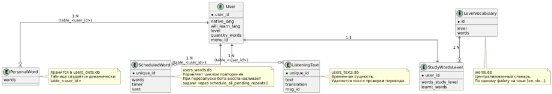

# 🗣️ LearnForeignLanguage — AI-Powered Language Tutor Bot


An asynchronous, AI-driven Telegram bot for personalized foreign language learning across **5 languages** (English, German, Spanish, French, Italian) and **CEFR levels (A1–C1)**. 

Built with a hybrid **Cloud / Edge-AI architecture**, combining LLM tutoring, speech-to-text/text-to-speech pipelines, semantic vector guardrails, and scientifically backed spaced repetition.

---

## ✨ Key Features

* **🎯 Adaptive Onboarding & Dynamic UI:** Evaluates the user's CEFR level (`A1–C1`) via an adaptive placement test (`*_questions.py`) or manual selection. Automatically switches the bot's interface language to the target language starting from **B1** for full immersion.
* **🧠 Spaced Repetition System (SRS):** Implements the **Ebbinghaus Forgetting Curve** with automated review intervals (`30m → 8h → 24h → 72h`). Persistent task scheduling (`schedule_all_pending_repeats()`) ensures zero data loss across bot restarts.
* **📚 3-Stage Vocabulary Trainer:** Interactive memorization pipeline (Translation recognition → Original word recall → Active spelling with masked hints) paired with synthesized pronunciation audio tracks (`Words.mp3`).
* **🎙️ Voice & Text AI Conversation Partner:** Real-time dialogue practice supporting both text and voice messages. Provides instant grammar corrections, natural phrasing suggestions, and on-demand translations.
* **🎧 AI Listening & Writing Modules:** Generates level-adjusted texts and audio comprehension tests on any user-defined topic (`essay.py`, `text.py`). Evaluates user translations and essays with detailed error breakdowns.
* **🛡️ Semantic Content Guardrails:** Prevents off-topic or inappropriate prompts using vector similarity search (**`deepvk/USER-bge-m3`** embeddings + **`FAISS`** index) before hitting the LLM.

---

## 🏗️ System Architecture & Tech Stack

The system supports **two interchangeable inference modes**: **Cloud API** (for low-latency external inference) and **Local Edge Mode** (for offline autonomy and data privacy on ARM hardware).

| Component | Cloud Mode | Local / Edge Mode |
| :--- | :--- | :--- |
| **Bot Framework** | `aiogram 3.2+` (Asyncio) | `aiogram 3.2+` (Asyncio) |
| **LLM Engine** | OpenAI / DeepSeek API (`translate_API.py`) | `google/gemma-3n-e4b` (`local_model.py`) |
| **Speech-to-Text (STT)** | Deepgram / AssemblyAI (`speech_to_text.py`) | `Whisper-large-v3-turbo` (`model_speech_to_text.py`) |
| **Text-to-Speech (TTS)** | gTTS (`text_to_speech.py`) | gTTS |
| **Semantic Guardrails** | `deepvk/USER-bge-m3` + `FAISS` | `deepvk/USER-bge-m3` + `FAISS` |
| **Database** | SQLite + `aiosqlite` (`db.py`) | SQLite + `aiosqlite` (`db.py`) |
| **Target Hardware** | Cloud VDS (Linux) | **Orange Pi Zero 3** (Armbian Debian 12) |

### Database Architecture
To prevent I/O locks under concurrent user sessions, data is decoupled across specialized asynchronous SQLite databases:
* `users_dicts.db` — dynamically generated per-user personal vocabulary tables (`table_<user_id>`).
* `users_words.db` — spaced-repetition timers and persistent reminder queues.
* `users_texts.db` — temporary listening and translation session states.
* `words.db` — centralized multi-language CEFR vocabulary banks.

<!--  -->

---

## 📂 Project Structure

```text
LearnForeignLanguage/
├── langs/                     # Localization & multi-language UI strings
├── main.py                    # Bot entry point & startup scheduler recovery
├── handlers.py                # Async aiogram message & callback routers
├── keyboards.py               # Dynamic inline keyboards & UI builders
├── db.py                      # Async SQLite connection & query layer (aiosqlite)
├── config.py                  # Environment variables & API configuration
├── local_model.py             # Local LLM inference pipeline (Gemma)
├── model_speech_to_text.py    # Local STT inference pipeline (Whisper)
├── model_translate.py         # Local translation & evaluation module
├── translate_API.py           # Cloud LLM API integration (OpenAI / DeepSeek)
├── speech_to_text.py          # Cloud STT integration (Deepgram / AssemblyAI)
├── text_to_speech.py          # Audio synthesis (gTTS)
├── essay.py & text.py         # Writing, translation & listening comprehension logic
├── *_questions.py             # CEFR placement test question banks (EN, DE, ES, FR, IT)
├── utils.py                   # Helper functions & text formatting
├── requirements.txt           # Project dependencies
└── .env.example               # Environment variables template
```

---

## 🚀 Quick Start

### 1. Clone the repository
```bash
git clone https://github.com
cd LearnForeignLanguage
```

### 2. Set up a virtual environment & install dependencies
```bash
python -m venv venv
source venv/bin/activate  # On Windows: venv\Scripts\activate
pip install -r requirements.txt
```

### 3. Configure environment variables
Copy the example template and fill in your API keys:
```bash
cp .env.example .env
```
Edit `.env`:
```env
BOT_TOKEN=your_telegram_bot_token_here
bot_hub_API=your_bot_hub_api_key_here
deepgram_API=your_deepgram_api_key_here
deepseek_API=your_deepseek_api_key_here
speech_to_text_API_assemblyai=your_assemblyai_api_key_here
```

### 4. Run the bot
```bash
python main.py
```

---

## 🔮 Future Roadmap
* [ ] Docker & `docker-compose` containerization for one-command deployment.
* [ ] Migration to PostgreSQL + `pgvector` for high-concurrency scaling.
* [ ] FastAPI web dashboard for user analytics and custom vocabulary imports.

---

## 📄 Copyright
Copyright © 2026 Dmitry Volodin. All Rights Reserved.
This repository is published for portfolio and demonstration purposes only.
